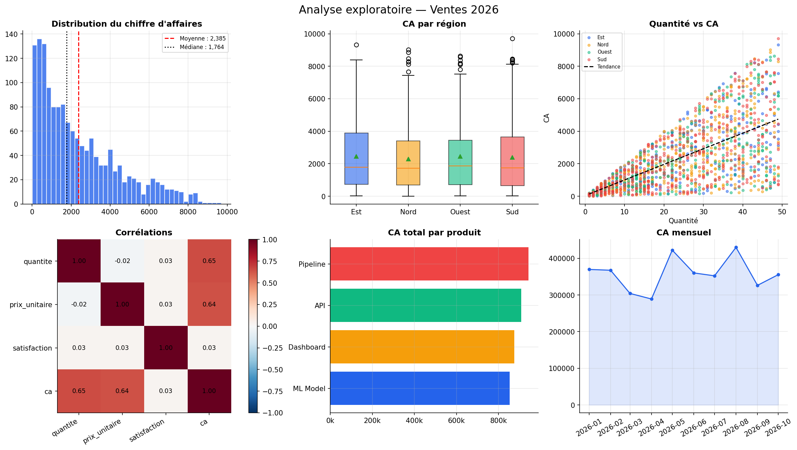
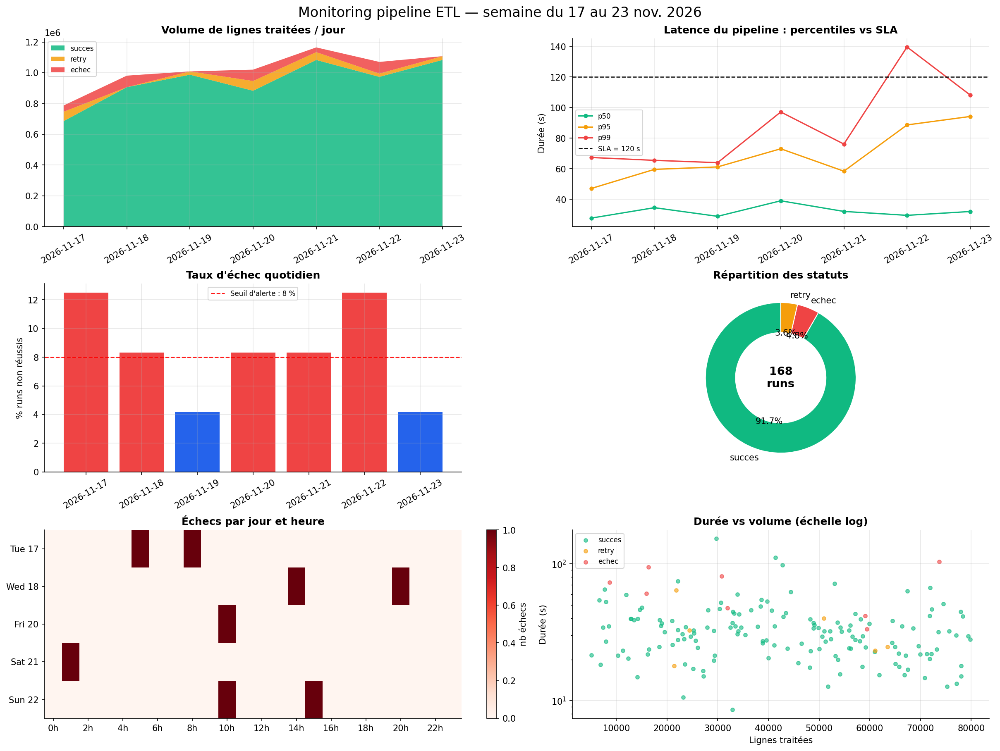
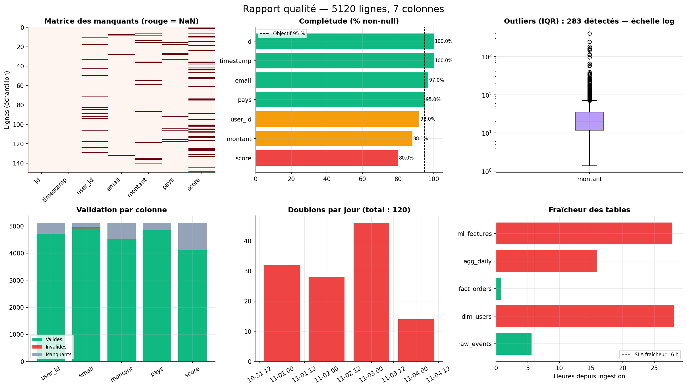
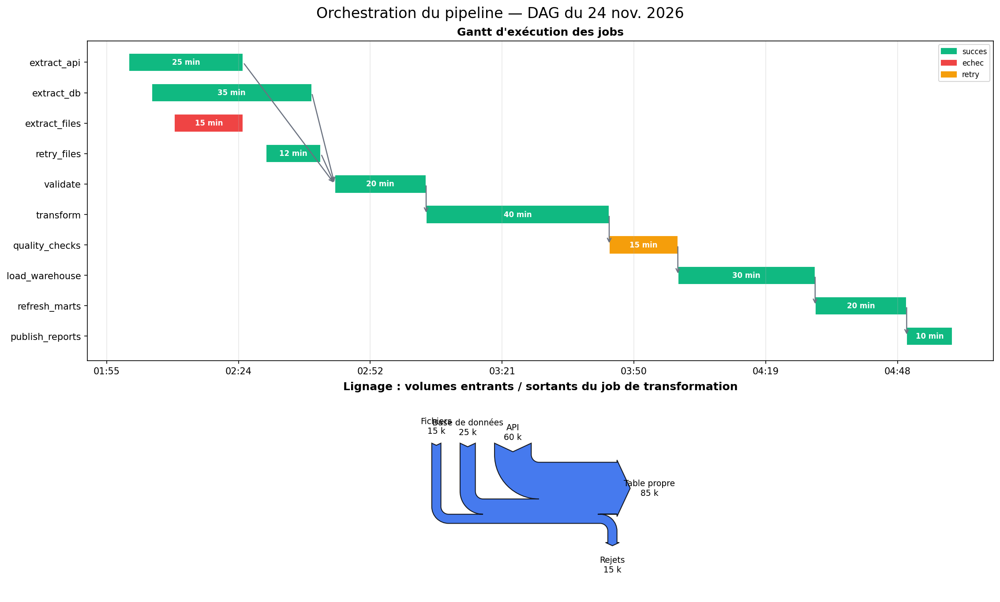

<div align="center">

#  matplotlib-data-projets

**7 scripts Python complets — analyse de données & ingénierie de données avec Matplotlib**

*« Je transforme les données en systèmes fiables : bases bien modélisées, pipelines lisibles et outils utiles à la décision. »*

[](https://www.python.org/)
[](https://numpy.org/)
[](https://pandas.pydata.org/)
[](https://matplotlib.org/)
[](LICENSE)
[](https://merphy-data-architect-kqextfs52-fullstackflow-devs-projects.vercel.app/)

</div>

---

## À propos

Collection de **7 scripts autonomes et reproductibles**, construite autour de mes trois
profils principaux - **ingénieur de données · ingénieur de bases de données · architecte
de données** - et de mes compétences d'**analyste de données Python & BI**.

Chaque script génère ses propres **données synthétiques** (seed fixe via `np.random.default_rng`) :
aucun fichier externe requis, résultats 100 % reproductibles. C'est exactement la philosophie
de mon **[Data Lab](https://merphy-data-architect-kqextfs52-fullstackflow-devs-projects.vercel.app/)** :
un espace de démonstration construit autour de données synthétiques, sans connexion à des
systèmes réels.

> Ce dépôt constitue la brique Python de la section **« Visualisation et pipelines »**
> (en préparation) de mon Data Lab : tableaux, graphiques et étapes ETL affichés à partir
> de traitements réels.

> *« Je préfère une ligne de code documentée et testée à cent lignes de code "magiques". »*

##  Les 7 scripts ↔ mes domaines d'expertise

| # | Fichier | Domaine (portfolio) | Contenu | Sortie |
|---|---------|--------------------|---------|--------|
| 1 | `01_eda_dashboard.py` | Analyse de données & BI | EDA : histogrammes, boxplots, scatter + régression, corrélations, KPI mensuels | `01_eda_dashboard.png` |
| 2 | `02_serie_temporelle.py` | Analyse & statistiques | Tendance, saisonnalité, ±2σ glissant, anomalies (z-score), heatmap calendaire | `02_serie_temporelle.png` |
| 3 | `03_distributions.py` | Analyse & statistiques | Violin plots, ECDF (p50/p95/p99), QQ-plot, densités - latences d'API | `03_distributions.png` |
| 4 | `04_monitoring_etl.py` | Data Engineering | Pipelines ETL/ELT : volumes par statut, percentiles vs SLA, taux d'échec, heatmap jour × heure | `04_monitoring_etl.png` |
| 5 | `05_data_quality.py` | Qualité & automatisation | Manquants, complétude, outliers IQR, validation, doublons, fraîcheur des tables | `05_data_quality.png` |
| 6 | `06_orchestration.py` | Architecture des données | Gantt de DAG façon Airflow + Sankey de lignage (flux entrants/sortants) | `06_orchestration.png` |
| 7 | `07_monitoring_temps_reel.py` | Data Engineering / DevOps | Dashboard animé (`FuncAnimation`) : débit & latence d'un flux type Kafka | *(fenêtre interactive)* |

##  Écosystème - liens avec mes projets

Ce dépôt complète mes réalisations présentées sur mon portfolio :

- **MIRAH-BI Urban Mobility Analytics** & **MIRAH-BI Test Platform** - les scripts 4, 5 et 6
  reproduisent les dashboards de monitoring, contrôles qualité et vues d'orchestration
  utilisés pour préparer, tester et valider les pipelines de la plateforme MIRAH-BI ;
- **WAL Transit Engine - West Africa Logistics Analytics** - même organisation
  **Bronze / Silver / Gold** : le script 5 contrôle la qualité entre les couches,
  le script 6 visualise le lignage ;
- **Dakar Weather Intelligence (DWI)** - le script 2 (séries temporelles + anomalies)
  s'applique directement aux données météorologiques ;
- **Pipeline ETL analytique** & **Automatisation ETL en Python** - les scripts 4 et 6
  documentent visuellement l'exécution des jobs (Airflow, dbt, Snowflake) ;
- **API métier avec FastAPI** - le script 3 compare les distributions de latences
  entre versions d'API ;
- **Dashboard de ventes Power BI** - le script 1 est l'équivalent Python/EDA de
  l'analyse descriptive commerciale.

##  Compétences démontrées

| Domaine | Mises en pratique dans ce dépôt |
|---|---|
| **Ingénierie des données** | ETL/ELT, ingestion multi-sources, orchestration (DAG/Gantt), qualité & validation, Bronze/Silver/Gold |
| **Bases de données & architecture** | Fraîcheur des tables, lignage (Sankey), volumétrie, intégrité et cohérence des données |
| **Analyse de données & BI** | EDA, analyse statistique (ECDF, QQ-plot, z-score, IQR), KPI, data storytelling, visualisation |
| **DevOps & bonnes pratiques** | Seeds fixes (reproductibilité), backend `Agg` (headless/CI), exports 150 dpi, nommage `snake_case`, code documenté |

**Stack :** Python · Pandas · NumPy · Matplotlib — le trio analytique de mon portfolio,
complémentaire de SQL (PostgreSQL, MySQL, SQL Server), Airflow et Power BI.

## 📁 Structure

```text
matplotlib-data-projets/
├── 01_eda_dashboard.py
├── 02_serie_temporelle.py
├── 03_distributions.py
├── 04_monitoring_etl.py
├── 05_data_quality.py
├── 06_orchestration.py
├── 07_monitoring_temps_reel.py
├── requirements.txt
├── README.md
└── assets/                  # captures des figures pour ce README
```

## Installation

> **Python 3.13, 3.14 ou 3.15** - recommandé : **3.14** (écosystème data le plus mature).
> Minimum technique : 3.11 (imposé par pandas 3.x / Matplotlib 3.11).

```bash
git clone https://github.com/<TON_PSEUDO>/matplotlib-data-projets.git   # TODO: URL GitHub
cd matplotlib-data-projets

# Environnement virtuel - choisir SA version
py -3.14 -m venv .venv          # Windows (py launcher)
# python3.14 -m venv .venv      # Linux / macOS

.venv\Scripts\activate          # Windows
# source .venv/bin/activate     # Linux / macOS

pip install -r requirements.txt
```

## Utilisation

```bash
python 01_eda_dashboard.py           # → 01_eda_dashboard.png
python 04_monitoring_etl.py          # → 04_monitoring_etl.png
python 07_monitoring_temps_reel.py   # → animation (en local uniquement)
```

**Mode headless (serveur, CI/CD, Docker)** - avant l'import de `pyplot` :

```python
import matplotlib
matplotlib.use("Agg")   # aucun écran requis ; export via fig.savefig()
```

## Aperçus

| EDA | Monitoring ETL |
|-----|----------------|
|  |  |

| Qualité des données | Orchestration |
|---------------------|---------------|
|  |  |

## Roadmap

- [ ] Brancher les scripts sur des données réelles (CSV / PostgreSQL / SQL Server)
- [ ] Intégrer les figures à la section **« Visualisation et pipelines »** du Data Lab
- [ ] Exposer les scripts 4 et 5 comme endpoints **FastAPI** (cohérent avec mon API métier)
- [ ] Planifier la génération des rapports avec **Airflow**
- [ ] Pipeline **GitHub Actions** : exécution headless des scripts à chaque push
- [ ] Publier un article associé dans la section **Écrits** du portfolio

## 👤 Auteur

**Merphy Mademba** - Ingénieur de données & architecte de bases de données · Dakar, Sénégal 🇸🇳

*Data · Architecture · Analytics - Des fondations solides pour mieux décider.*

- 🌐 [Portfolio](https://merphy-data-architect-kqextfs52-fullstackflow-devs-projects.vercel.app/)
- LinkedIn : [Merph-dev](https://www.linkedin.com/in/merph-dev) <!-- TODO: URL LinkedIn (lien du footer de ton portfolio) -->
- GitHub : [FullStackFlow-dev](https://github.com/FullStackFlow-dev) <!-- TODO: URL GitHub -->
- 📧 Email : [merphy.softwareengineer@gmail.com](merphy.softwareengineer@gmail.com>) <!-- TODO: email -->

**Formation continue :** Meta · IBM · Microsoft · DataCamp
✅ Certifié : Microsoft Python Developer · Data Engineer Python & SQL · PostgreSQL Administrator · Johns Hopkins (Coursera)
🔄 En cours : IBM Data Engineering · Meta Database Engineer

## Licence

MIT - voir `LICENSE`. Données 100 % synthétiques : aucune donnée réelle ou confidentielle
(même principe que le Data Lab : aucune connexion à une plateforme ou entreprise n'est utilisée).

© 2026 - Merphy Mademba